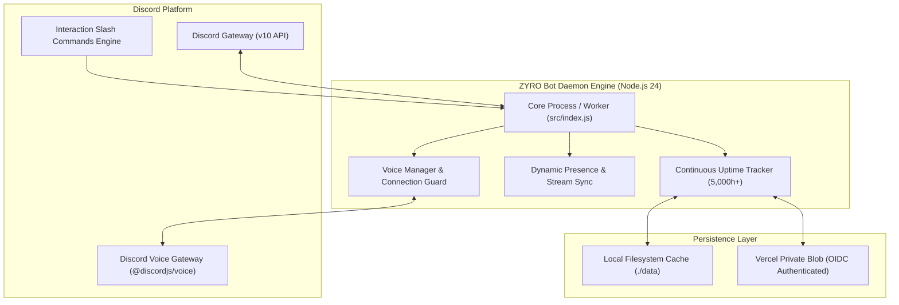

<!-- ========================================================================= -->
<!-- ZYRO STREAMING BOT — HIGH-AVAILABILITY 24/7 DISCORD AUDIO DAEMON          -->
<!-- ========================================================================= -->

<div align="center">
  <!-- Dynamic Banner -->
  

  <p align="center">
    <strong>Enterprise-grade, containerized Discord 24/7 voice streaming daemon with automatic reconnection, dynamic rich presence, and Vercel Blob cloud persistence.</strong>
  </p>

  <p align="center">
    
    
    
    
    
  </p>

  <p align="center">
    <a href="#-key-features">Features</a> •
    <a href="#-slash-commands-suite">Commands</a> •
    <a href="#-architecture--flow">Architecture</a> •
    <a href="#-environment-variables">Configuration</a> •
    <a href="#-deployment-guide">Deployment</a> •
    <a href="zyro-vercel-daemon/zyro-vercel-daemon/README_SI.md">සිංහල මාර්ගෝපදේශය</a>
  </p>
</div>

---

## ⚡ Overview

**ZYRO Streaming Bot** is an ultra-reliable, high-availability Node.js service engineered to keep your Discord bot pinned 24/7 in a selected voice channel while maintaining a synchronized Twitch / YouTube streaming status and continuous uptime counter.

Engineered natively for **Vercel Daemons (Docker Worker architecture)** and multi-platform deployments, it integrates **Vercel Private Blob storage** with continuous **OIDC token rotation** to ensure server configurations and uptime timers persist indefinitely across container recycles.

---

## 🚀 Key Features

- 🔊 **24/7 Pinned Voice Channel:** Seamlessly connects to specified guild voice channels with persistent keep-alive and exponential-backoff auto-reconnect logic.
- 📺 **Dynamic Streaming Activity:** Sets rich Discord streaming presence linking to any Twitch or YouTube broadcast URL.
- 🗄️ **Zero-Loss State Persistence:** Synchronizes timer milestones (5,000+ hours) and per-guild configuration via Vercel Private Blob with automatic OIDC token refresh.
- 🎛️ **Native Slash Commands:** Full Discord interaction engine with built-in permission checks (`ManageGuild`), interactive feedback, and ephemeral security.
- 🐳 **Universal Containerization:** Production-ready `Dockerfile` optimized for Vercel Daemons, Railway, Fly.io, VPS, or self-hosted Docker environments.
- 🛡️ **Defensive Architecture:** Strict environment schema validation, zero crashing on Discord gateway hiccups, and comprehensive unit tests.

---

## 🏗️ Architecture & Flow



---

## 🎛️ Slash Commands Suite

All commands are registered natively through the Discord REST API with granular permissions:

| Command | Arguments | Permissions | Description |
| :--- | :--- | :---: | :--- |
| **`/setvoice`** | `channel` *(Guild Voice)* | `ManageGuild` | Selects and pins the voice channel the bot must occupy 24/7. |
| **`/setstream`**| `url` *(Twitch/YouTube HTTPS)* | `ManageGuild` | Updates the global streaming activity URL displayed on the bot's profile. |
| **`/status`**   | *None* | `Everyone` | Displays real-time voice gateway connection state, ping, and guild health. |
| **`/timer`**    | *None* | `Everyone` | Inspects the continuous streaming timer and total accumulated operating hours. |
| **`/reset`**    | `hours` *(Min 5,000)* | `ManageGuild` | Recalibrates or resets the global milestone streaming timer. |

---

## ⚙️ Environment Variables

Configure these variables in your deployment dashboard or local `.env` file:

| Variable | Required | Default | Description |
| :--- | :---: | :---: | :--- |
| `BOT_TOKEN` | **Yes** | — | Secret Discord Bot Token from the Discord Developer Portal. |
| `DEFAULT_STREAM_URL` | Optional | `""` | Fallback Twitch or YouTube HTTPS streaming link. |
| `BASE_ELAPSED_HOURS` | Optional | `5000` | Minimum base starting hours for the uptime counter. |
| `DATA_DIR` | Optional | `./data` | Local directory for cached state persistence. |
| `PRESENCE_UPDATE_INTERVAL_MS`| Optional | `60000` | Presence heartbeat update interval in milliseconds (min `60000`). |
| `VOICE_RECONNECT_DELAY_MS` | Optional | `5000` | Initial voice reconnection delay on disconnect (ms). |
| `VOICE_RECONNECT_MAX_DELAY_MS` | Optional | `60000` | Maximum exponential backoff ceiling for voice reconnection. |
| `DEV_GUILD_ID` | Optional | — | Target Guild ID for immediate slash command deployment during development. |

---

## 🚀 Deployment Guide

### Option 1: Deploy on Vercel (Vercel Daemons)

1. **Import Repository:** Go to [Vercel Dashboard](https://vercel.com/dashboard) → **Add New** → **Project**, and import this repository.
2. **Root Directory:** Keep the root directory set to the repository root.
3. **Set Up Storage:**
   - Under the project's **Storage** tab, create a new **Vercel Blob** store.
   - Set Access Type to **Private**.
   - Connect the Blob store to your Project (Production environment).
4. **Environment Variables:**
   - Under **Project Settings → Environment Variables**, add your `BOT_TOKEN` and desired configuration.
5. **Deploy:** Trigger a deployment. Monitor logs under **Deployments → Production → Logs / Daemons → `zyro-bot`**.

> [!NOTE]
> Vercel Daemons require a Production deployment to initialize active compute instances.

### Option 2: Run with Docker

```bash
# Navigate to the worker directory
cd zyro-vercel-daemon/zyro-vercel-daemon/worker

# Build the production container
docker build -t zyro-streaming-bot .

# Run container with persistent data volume
docker run -d \
  --name zyro-bot \
  --restart always \
  -e BOT_TOKEN="your_discord_bot_token" \
  -e DEFAULT_STREAM_URL="https://twitch.tv/your_channel" \
  -v $(pwd)/data:/app/data \
  zyro-streaming-bot
```

### Option 3: Local Development & Verification

```bash
cd zyro-vercel-daemon/zyro-vercel-daemon/worker

# Install dependencies
npm install

# Run static syntax & consistency checks
npm run check

# Run automated unit test suite
npm test

# Start bot process
npm start
```

---

## 🔒 Discord Bot Privileged Intents

To ensure proper gateway handshakes and voice packet routing, verify the following in the [Discord Developer Portal](https://discord.com/developers/applications):

1. **OAuth2 URL Generator Scopes:**
   - `bot`
   - `applications.commands`
2. **Bot Permissions:**
   - `View Channels`
   - `Connect`
   - `Speak`
   - `Use Embedded Activities` (Optional)

---

## 🇱🇰 සිංහල මාර්ගෝපදේශය (Sinhala Guide)

සම්පූර්ණ project setup එක, Vercel Hobby plan එකේ සීමාවන් සහ Blob storage සම්බන්ධ කරන ආකාරය පිළිබඳ සිංහල මාර්ගෝපදේශය සඳහා **[README_SI.md කියවන්න](zyro-vercel-daemon/zyro-vercel-daemon/README_SI.md)**.

---

## 👨‍💻 Author & Maintainer

**Thenuda Sahas Sooriyaarachchi**
- 🌐 Portfolio: [thenudasahas.site](https://www.thenudasahas.site/)
- 🐙 GitHub: [@thenudasahas2008](https://github.com/thenudasahas2008)
- 💬 Discord: `zyrox_01xi`

---

<div align="center">
  <sub>Built with ❤️ for 24/7 Discord Audio Streaming. Licensed under the MIT License.</sub>
</div>
